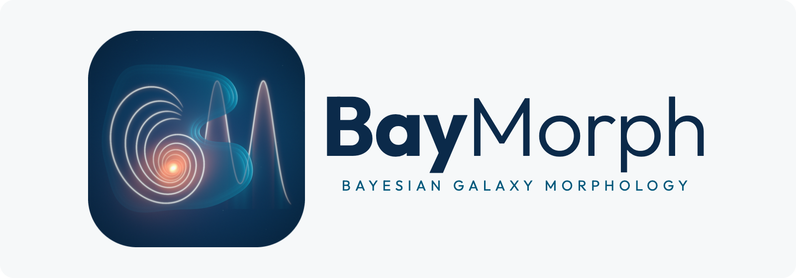

<h1 align="center">
  <picture>
    <source media="(prefers-color-scheme: dark)" srcset="docs/assets/logo/baymorph-lockup-dark.png">
    
  </picture>
</h1>

  
  
  

  <a href="https://carlocannarozzophd.github.io/BayMorph/">Documentation</a> ·
  <a href="#installation">Installation</a> ·
  <a href="#quick-start">Quick Start</a> ·
  <a href="docs/reference/API.md">API</a> ·
  <a href="CHANGELOG.md">Changelog</a>

---

> **Need galaxy morphology?**
>
> **BayMorph.**
>
> Need Bayesian inference?
>
> **BayMorph.**
>
> Need a relaxing afternoon by the bay?
>
> Sorry. We only borrowed the name.

---

> [!IMPORTANT]
>
> BayMorph is under active scientific development. The model of real
> observations, the rendering under an empirical PSF, the noise and the sky
> background, is being revised and validated, and no fit of a real image has
> yet been validated scientifically. Interfaces and defaults may change.

## What is BayMorph?

BayMorph is an open-source Python framework for Bayesian inference of galaxy
morphology from one or more observations of the same object.

Rather than treating galaxy fitting as the optimization of an analytical
profile evaluated at detector pixels, BayMorph models the observation process
that connects an intrinsic light distribution to the measured detector data.
Its architecture keeps separate the intrinsic morphology, the observation
model, the numerical rendering, the probabilistic inference, the inference
backend, the workflow and the validation. Posterior distributions, parameter
degeneracies and Bayesian evidence are its scientific products.

> **Galaxy morphology is fundamentally an inference problem, not merely an
> optimization problem.**

## Why BayMorph?

Morphology analyses commonly need separate tools for image preparation,
source detection, masking, PSF construction, forward modelling, Bayesian
inference and diagnostics, which makes their assumptions hard to trace.
BayMorph assembles these steps in one framework whose components stay
modular, explicit and independently tested. Configuration files define
analyses; notebooks are user workflows, not hidden implementations.

## Scientific scope

BayMorph covers galaxy morphology from astronomical images, single- and
multi-observation Bayesian inference with conditional independence across
observations stated explicitly, reproducible workflows and their
validation. It does not cover stellar populations, spectral-energy-
distribution fitting, dust, radiative transfer, residual covariance between
observations, or survey-level population inference.

## Current capabilities

| Area | Capability |
| --- | --- |
| Observation preparation | FITS ingestion, target identification, automatic and fixed cutouts, constant background subtraction, a robust sky noise scale, exclusion of impossibly negative pixels |
| Detection and masking | Source detection and segmentation, masking of the detected sources that stand out above the light of the target, external masks |
| Morphology models | Ten models built from nine components. For one image or several: single Sérsic, two labelled Sérsic components, Sérsic plus point source, bulge and disc. For one image: boxy or discy Sérsic, core-Sérsic, bulge and broken disc, and bulge and disc with a bar, a ring or two spiral arms |
| Rendering | Detector-pixel integration, and effective-PSF rendering of empirical PSFs with sub-pixel kernels |
| PSF | Analytic Gaussian PSFs; empirical PSFs built from the stars of the image, with sub-pixel kernels and extended wings |
| Likelihoods | The same noise model for single and joint fits: a normalized Gaussian whose variance is the prepared sky scale squared plus the source part of the model over a declared effective gain, with the stationary correlation of the sky through a 24-neighbour factorization. Cash and Poisson-Gaussian likelihoods for images in counts. The independent Gaussian remains for simulations through the Python API |
| Inference | Backend-neutral inference problems with Nautilus (default), Dynesty (static and dynamic nested sampling) and pocoMC |
| Results | Weighted posterior samples, Bayesian evidence, diagnostics and provenance in a backend-neutral `InferenceResult` |
| Multi-observation inference | One joint workflow with explicit coupling across observations (shared, independent, hierarchical, wavelength-dependent) and conditionally factorized likelihoods |
| Validation | Mathematical, numerical, statistical, backend and workflow validation infrastructure, including simulation-based calibration |
| Model screening | Experimental simulation-trained ranking, frozen; the choice of model remains the user's |

## Architecture

BayMorph is observation-centred and backend-neutral:

    Physical object
          |
          v
    Observation-specific intrinsic representation
          |
          v
    Observation operator
          |
          v
    Expected detector measurement
          |
          v
    Likelihood
          |
          v
    Inference problem
          |
          v
    Numerical backend
          |
          v
    InferenceResult

Changing among Nautilus, Dynesty and pocoMC does not change the scientific
model, the prior, the likelihood, the meaning of a parameter or the
interpretation of a result.

## Installation

BayMorph requires Python 3.11 or later:

~~~bash
conda create -n baymorph -c conda-forge python=3.11 -y
conda activate baymorph

python -m pip install --upgrade pip
python -m pip install "git+https://github.com/carlocannarozzophd/BayMorph.git@main"

baymorph --version
~~~

The installation includes the three supported inference backends. BayMorph
distributes software, example configurations, tutorial notebooks and tests.
It does not include observational data, and it does not include generated
results such as run directories, posteriors, benchmark tables or figures.

To install from a clone of the repository, with the development tools:

~~~bash
git clone https://github.com/carlocannarozzophd/BayMorph.git
cd BayMorph
python -m pip install -e ".[dev]"
~~~

## Quick start

~~~bash
baymorph init my_analysis
cd my_analysis
baymorph run configs/simulated_galaxy.yaml
~~~

`init` creates a workspace with the example configuration and the tutorial
notebooks; `run` simulates a galaxy, prepares the image, fits it and writes
the diagnostics under `runs/`. For an observed image, generate a
configuration, review it, and run it:

~~~bash
baymorph config data/galaxy.fits \
  --target-x 500 --target-y 500 \
  --model single_sersic \
  --uniform-prior flux 100 1000000 \
  --output configs/galaxy.yaml

baymorph run configs/galaxy.yaml
~~~

The same workflow from Python:

~~~python
from baymorph import BayMorphRunner

runner = BayMorphRunner("configs/galaxy.yaml")
result = runner.run(diagnostics=True)
~~~

The [quick start](docs/guide/QUICK_START.md) explains each step, the
[user guide](docs/guide/index.md) shows every stage on its own, the
[command-line reference](docs/reference/CLI.md) lists every option, and the
[configuration reference](docs/reference/CONFIGURATION.md) every key,
including the sampler settings, which keep the native names of each backend.

## Documentation

The documentation site is <https://carlocannarozzophd.github.io/BayMorph/>.
Its sources are under [`docs/`](docs/index.md):

| Document | Purpose |
| --- | --- |
| [Getting Started](docs/guide/QUICK_START.md) | Installation, a first fit and the tutorial notebooks |
| [User Guide](docs/guide/index.md) | Every stage of an analysis, with the code to run and inspect it |
| [Models](docs/models/index.md) | The galaxy models and their components, the PSFs, the noise models, the sky and the residual background |
| [Theory](docs/theory/BAYESIAN_INFERENCE.md) | Bayesian inference, nested sampling and hierarchical models |
| [Reference](docs/reference/CONFIGURATION.md) | The command line, every configuration key, the output files and the Python API |
| [Changelog](CHANGELOG.md) | The release history |

To build the site locally:

~~~bash
python -m pip install -r requirements-docs.txt
python -m zensical serve
~~~

## Development status

BayMorph is a scientific research programme and an evolving Python package.
Sampling is delegated to established nested-sampling backends. The long-term
objective is coherent Bayesian inference from several observations of the
same object, with every dependence assumption stated explicitly.

## Contributing

Contributions are welcome: open an issue or a pull request on GitHub.
Changes to scientific models, priors, likelihoods, rendering, inference,
results or public interfaces must come with their tests, their validation
and their documentation, and pass `ruff check .` and `python -m pytest`.

## Citation

Citation metadata are provided in [`CITATION.cff`](CITATION.cff). When using a
development version of BayMorph in scientific work, record the BayMorph
version, the Git commit, the resolved configuration, the provenance of the
input data, and the inference and rendering configuration. Citation
information for the BayMorph paper will be added when the manuscript is
released.

## License

BayMorph is distributed under the MIT License; see [`LICENSE`](LICENSE).
