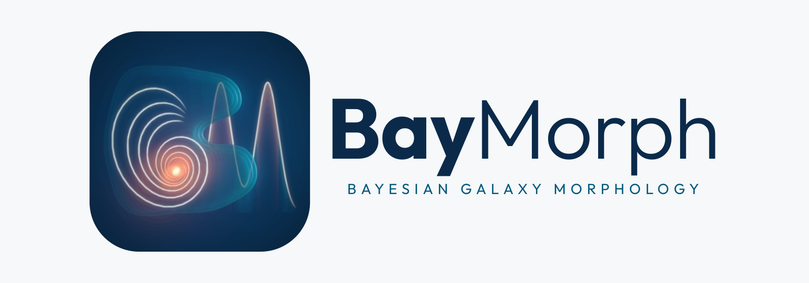

<h1 align="center">
  <picture>
    <source media="(prefers-color-scheme: dark)" srcset="docs/assets/logo/baymorph-lockup-dark.svg">
    
  </picture>
</h1>

  
  
  

  <a href="https://carlocannarozzophd.github.io/BayMorph/">Documentation</a> ·
  <a href="#installation">Installation</a> ·
  <a href="#quick-start">Quick Start</a> ·
  <a href="docs/reference/API.md">API</a> ·
  <a href="CHANGELOG.md">Changelog</a>

---

> **Need galaxy morphology?**
>
> **BayMorph.**
>
> Need Bayesian inference?
>
> **BayMorph.**
>
> Need a relaxing afternoon by the bay?
>
> Sorry. We only borrowed the name.

---

> [!IMPORTANT]
>
> BayMorph is under active scientific development. The model of real
> observations, the rendering under an empirical PSF, the noise and the sky
> background, is being revised and validated, and no fit of a real image has
> yet been validated scientifically. Interfaces and defaults may change.

## What is BayMorph?

BayMorph is an open-source Python package for the Bayesian inference of
galaxy morphology from one or more images of the same object. It models how
an intrinsic light distribution becomes the measured detector data, through
the PSF, the pixels, the sky and the noise, and returns the posterior
distribution of the parameters of a morphology model together with the
Bayesian evidence.

> **Galaxy morphology is fundamentally an inference problem, not merely an
> optimization problem.**

From a FITS image and one configuration file, BayMorph:

- reads the header through the conventions of the main telescopes and
  pipelines, and asks you to declare only what the header does not
  establish;
- cuts out the target, masks the other sources, and measures the sky and the
  noise;
- builds the PSF from the stars of the same image;
- fits one of ten morphology models, from a single Sérsic profile to a bulge
  and a disc with a bar, a ring or two spiral arms, with a likelihood that
  describes the noise of the sky, the Poisson noise of the galaxy and the
  correlation of neighbouring pixels;
- samples the posterior with Nautilus, Dynesty or pocoMC; the choice of
  backend changes neither the model, nor the prior, nor the likelihood;
- fits several images of the same galaxy jointly, with the coupling of every
  parameter across them stated explicitly.

It does not cover stellar populations, spectral energy distributions, dust,
radiative transfer, residual covariance between observations, or the
inference of galaxy populations.

## Installation

BayMorph requires Python 3.11 or later:

~~~bash
conda create -n baymorph -c conda-forge python=3.11 -y
conda activate baymorph
python -m pip install "git+https://github.com/carlocannarozzophd/BayMorph.git@main"
baymorph --version
~~~

The installation includes the three inference backends. BayMorph
distributes software, example configurations, tutorial notebooks and tests.
It does not include observational data, and it does not include generated
results such as run directories, posteriors, benchmark tables or figures.

## Quick start

Fit a simulated galaxy, packaged with BayMorph:

~~~bash
baymorph init my_analysis
cd my_analysis
baymorph run configs/simulated_galaxy.yaml
~~~

Fit an image of your own. The observation advisor reads its header, prepares
it, builds its PSF and proposes a configuration with the source of every
prior; `--accept` writes it after your review, and `run` fits it:

~~~bash
baymorph config data/galaxy.fits --target-ra 150.1 --target-dec 2.2 --advise
baymorph config data/galaxy.fits --target-ra 150.1 --target-dec 2.2 --advise --accept
baymorph run galaxy.yaml
~~~

The same fit from Python:

~~~python
from baymorph import BayMorphRunner

fit = BayMorphRunner("galaxy.yaml").run(diagnostics=True)
print(fit.posterior.summary("re"))
~~~

## Documentation

The documentation, <https://carlocannarozzophd.github.io/BayMorph/>, has a
[quick start](docs/guide/QUICK_START.md), a [user guide](docs/guide/index.md)
with one page for each stage of an analysis, the [models](docs/models/index.md),
the [theory](docs/theory/BAYESIAN_INFERENCE.md) behind the fit, and the
[reference](docs/reference/CONFIGURATION.md) of every command, configuration
key and output file. To build it locally, install `requirements-docs.txt`
and run `python -m zensical serve`.

## Contributing

Contributions are welcome: open an issue or a pull request on GitHub.
Changes to scientific models, priors, likelihoods, rendering, inference,
results or public interfaces must come with their tests, their validation
and their documentation, and pass `ruff check .` and `python -m pytest`.

## Citation

Citation metadata are provided in [`CITATION.cff`](CITATION.cff). When using a
development version of BayMorph in scientific work, record the BayMorph
version, the Git commit, the resolved configuration, the provenance of the
input data, and the inference and rendering configuration. Citation
information for the BayMorph paper will be added when the manuscript is
released.

## License

BayMorph is distributed under the MIT License; see [`LICENSE`](LICENSE).
